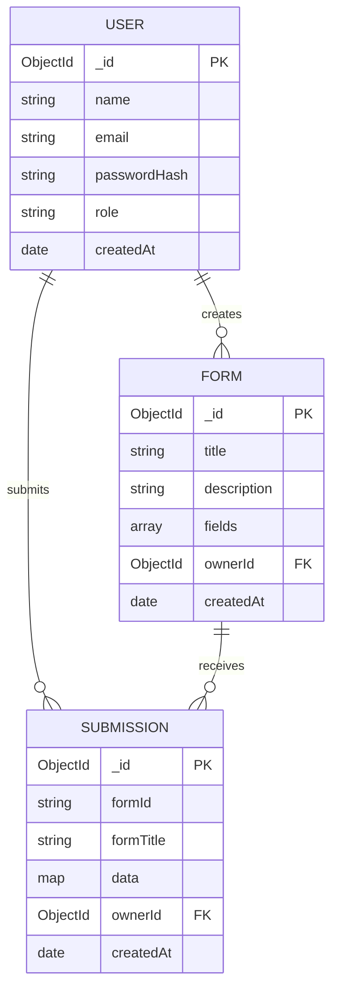

# 🗄️ Database Documentation — Forma-AI

> **Database:** MongoDB (Mongoose ODM)  
> **Local URI:** `mongodb://localhost:27017/forma-ai`  
> **Production URI:** MongoDB Atlas (configured via `MONGODB_URI` env var)

---

## Table of Contents

- [Overview](#overview)
- [Connection Configuration](#connection-configuration)
- [Data Models](#data-models)
  - [User](#1-user-model)
  - [Form](#2-form-model)
  - [Submission](#3-submission-model)
- [Entity-Relationship Diagram](#entity-relationship-diagram)
- [Indexes](#indexes)
- [Security Notes](#security-notes)

---

## Overview

Forma-AI uses **MongoDB** as its primary data store, accessed through the **Mongoose 9** ODM. The database consists of three main collections:

| Collection    | Purpose                                      |
|---------------|----------------------------------------------|
| `users`       | Registered accounts (auth credentials, roles) |
| `forms`       | Dynamic form schema definitions               |
| `submissions` | User-submitted form responses                 |

---

## Connection Configuration

**File:** [`backend/config/db.js`](../backend/config/db.js)

```js
import mongoose from 'mongoose';

const connectDB = async () => {
  const conn = await mongoose.connect(process.env.MONGODB_URI, {
    serverSelectionTimeoutMS: 5000,
    socketTimeoutMS: 45000,
  });
  console.log(`MongoDB connected: ${conn.connection.host}`);
};
```

### Environment Variables

| Variable       | Description                          | Example                              |
|----------------|--------------------------------------|--------------------------------------|
| `MONGODB_URI`  | Full MongoDB connection string       | `mongodb://localhost:27017/forma-ai` |

### Retry Logic

- **serverSelectionTimeoutMS:** 5 000 ms — fails fast if no server available
- **socketTimeoutMS:** 45 000 ms — keeps long-running aggregation queries alive
- If connection fails on startup, the process exits and the platform (Render) auto-restarts it

---

## Data Models

### 1. User Model

**File:** [`backend/models/User.js`](../backend/models/User.js)  
**Collection:** `users`

```js
{
  name:         String,   // required, full display name
  email:        String,   // required, unique, lowercase
  passwordHash: String,   // required, scrypt-derived hash (never plaintext)
  role:         String,   // enum: ['user', 'admin'], default: 'user'
  createdAt:    Date      // auto (timestamps: true)
  updatedAt:    Date      // auto (timestamps: true)
}
```

#### Field Details

| Field          | Type   | Required | Unique | Notes                                |
|----------------|--------|----------|--------|--------------------------------------|
| `name`         | String | ✅       | ❌     | Display name                         |
| `email`        | String | ✅       | ✅     | Lowercased before save               |
| `passwordHash` | String | ✅       | ❌     | Scrypt hash — **never stored plain** |
| `role`         | String | ❌       | ❌     | `user` or `admin`, default `user`    |
| `createdAt`    | Date   | —        | —      | Auto-managed by Mongoose             |
| `updatedAt`    | Date   | —        | —      | Auto-managed by Mongoose             |

#### Sample Document

```json
{
  "_id": "64ab12cd34ef5678ab901234",
  "name": "Chandru SM",
  "email": "chandru@example.com",
  "passwordHash": "$scrypt$N=16384,r=8,p=1$...",
  "role": "user",
  "createdAt": "2025-01-15T10:30:00.000Z",
  "updatedAt": "2025-01-15T10:30:00.000Z"
}
```

---

### 2. Form Model

**File:** [`backend/models/Form.js`](../backend/models/Form.js)  
**Collection:** `forms`

```js
{
  title:       String,    // required, e.g. "Job Application Form"
  description: String,    // optional summary
  fields:      [Object],  // array of field definition objects
  ownerId:     ObjectId,  // ref: 'User', required
  createdAt:   Date       // auto (timestamps: true)
  updatedAt:   Date       // auto (timestamps: true)
}
```

#### Field Object Shape

Each element in the `fields` array describes one form input:

```json
{
  "id":          "field_1",
  "type":        "text",
  "label":       "Full Name",
  "placeholder": "Enter your full name",
  "required":    true,
  "options":     []
}
```

| Property      | Type    | Notes                                               |
|---------------|---------|-----------------------------------------------------|
| `id`          | String  | Unique within the form                              |
| `type`        | String  | `text`, `email`, `number`, `select`, `textarea`, `date`, `checkbox`, `radio` |
| `label`       | String  | Display label                                       |
| `placeholder` | String  | Input hint text                                     |
| `required`    | Boolean | Client + server validation                          |
| `options`     | Array   | Only used for `select`, `radio`, `checkbox` types   |

#### Built-in Workflow Schemas

Five pre-seeded templates are loaded from [`backend/data/formSchemas.js`](../backend/data/formSchemas.js):

| Template              | Fields |
|-----------------------|--------|
| Insurance Claim       | 12     |
| Patient Intake        | 10     |
| Personal Loan         | 11     |
| Legal Intake          | 9      |
| Job Application       | 13     |

---

### 3. Submission Model

**File:** [`backend/models/Submission.js`](../backend/models/Submission.js)  
**Collection:** `submissions`

```js
{
  formId:    String,   // required, identifier of the submitted form
  formTitle: String,   // required, snapshot of form title at submission time
  data:      Map,      // key-value pairs of field id → submitted value
  ownerId:   ObjectId, // optional ref: 'User' (null for anonymous submissions)
  createdAt: Date      // auto (timestamps: true)
  updatedAt: Date      // auto (timestamps: true)
}
```

#### Field Details

| Field       | Type     | Required | Notes                                            |
|-------------|----------|----------|--------------------------------------------------|
| `formId`    | String   | ✅       | References the originating form                  |
| `formTitle` | String   | ✅       | Snapshot — preserved even if form is deleted     |
| `data`      | Map      | ✅       | `{ fieldId: "value", ... }`                      |
| `ownerId`   | ObjectId | ❌       | Linked to User if logged in; `null` if anonymous |
| `createdAt` | Date     | —        | Auto-managed                                     |
| `updatedAt` | Date     | —        | Auto-managed                                     |

#### Sample Document

```json
{
  "_id": "64ab99ff11cc2244bb556677",
  "formId": "job-application",
  "formTitle": "Job Application Form",
  "data": {
    "fullName": "Vishal Kumar",
    "email": "vishal@example.com",
    "position": "Frontend Developer",
    "experience": "2"
  },
  "ownerId": "64ab12cd34ef5678ab901234",
  "createdAt": "2025-01-20T14:45:00.000Z",
  "updatedAt": "2025-01-20T14:45:00.000Z"
}
```

---

## Entity-Relationship Diagram



---

## Indexes

| Collection    | Index                              | Type     | Purpose                                    |
|---------------|------------------------------------|----------|--------------------------------------------|
| `users`       | `email`                            | Unique   | Fast lookup by email, enforce uniqueness   |
| `submissions` | `ownerId` + `createdAt`            | Compound | Efficient pagination of user's submissions |
| `submissions` | `formId`                           | Single   | Filter submissions by form                 |
| `forms`       | `ownerId`                          | Single   | List forms by owner                        |

---

## Security Notes

- **Passwords** are hashed using **scrypt** (Node.js built-in `crypto.scryptSync`) — never stored in plaintext
- **JWT tokens** are signed with `AUTH_TOKEN_SECRET` using HMAC-SHA256
- **MongoDB Atlas** connections use TLS by default; local dev uses plain TCP
- **No sensitive fields** (like `passwordHash`) are returned in API responses — the User model uses a `.toJSON()` transform to strip them
- **Role-based access:** `admin` role can delete any form/submission; `user` role can only manage their own

---

*Last updated: November 2025 — Forma-AI v1.0*

