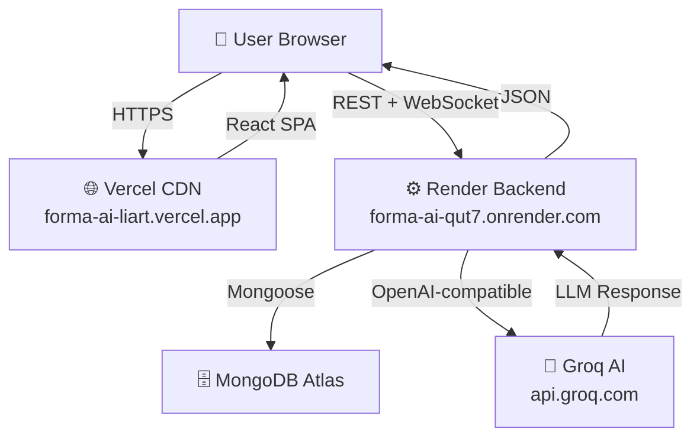
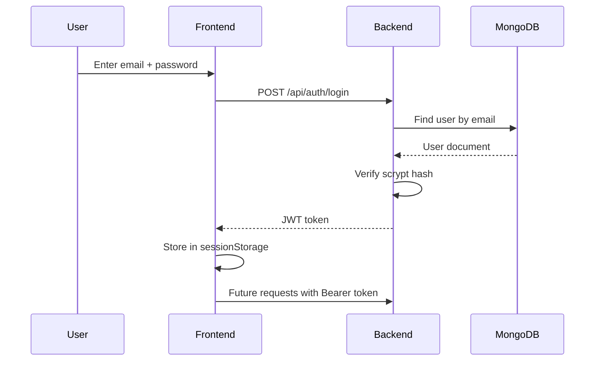
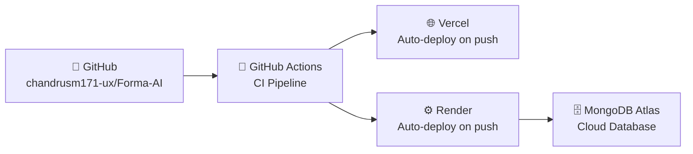

# 🎯 Forma-AI — Project Presentation

> **Team:** Chandru SM · Khushi · Vishal  
> **Program:** Axlero Internship — November 2025  
> **GitHub:** [chandrusm171-ux/Forma-AI](https://github.com/chandrusm171-ux/Forma-AI)

---

## Slide 1 — Title

# Forma-AI
### AI-Augmented Dynamic Form Engine

**Built with React · Node.js · Express · MongoDB · Groq AI**

---

> Live Demo:
> - 🌐 Frontend: [forma-ai-liart.vercel.app](https://forma-ai-liart.vercel.app)
> - ⚙️ Backend: [forma-ai-qut7.onrender.com](https://forma-ai-qut7.onrender.com)
> - 📂 GitHub: [github.com/chandrusm171-ux/Forma-AI](https://github.com/chandrusm171-ux/Forma-AI)

---

## Slide 2 — The Problem

# Why Do Forms Feel Broken?

| Pain Point                 | Impact                                       |
|----------------------------|----------------------------------------------|
| Manual data entry          | Slow, error-prone, repetitive                |
| No document intelligence   | Can't auto-fill from resumes or reports      |
| No real-time collaboration | Teams can't fill forms together              |
| Static field structure     | Same form for every use case                 |
| No submission history      | Users can't review past responses            |

> **Result:** High form abandonment rates, lost data, and wasted time in enterprise workflows.

---

## Slide 3 — Our Solution

# Introducing Forma-AI

**An AI-powered form engine that thinks for you**

```
📝 Dynamic Forms        → Configurable field types for any workflow
🤖 AI Extraction        → Paste text → fields auto-populate
📄 Resume Parser        → Upload DOCX → Job application pre-filled
👥 Real-Time Collab     → Multiple users, one form, zero conflicts
🔐 Secure Auth          → JWT + scrypt, role-based access
📋 Submission History   → Review all past responses
🚀 Production Deploy    → Vercel + Render + MongoDB Atlas
```

---

## Slide 4 — Technology Stack

# What We Built With

### Frontend
| Tool            | Purpose                     |
|-----------------|-----------------------------|
| React 19        | UI framework                |
| Vite 6          | Build tool                  |
| Zustand 5       | State management            |
| React Hook Form | Form validation             |
| Tailwind CSS    | Styling                     |
| Socket.IO + Yjs | Real-time CRDT collaboration|

### Backend
| Tool            | Purpose                     |
|-----------------|-----------------------------|
| Node.js 20      | Runtime                     |
| Express 5       | REST API framework          |
| MongoDB 7       | Document database           |
| Mongoose 9      | ODM                         |
| Socket.IO 4     | WebSocket server            |
| JWT + Scrypt    | Secure authentication       |

### AI & Infrastructure
| Tool            | Purpose                     |
|-----------------|-----------------------------|
| Groq API        | LLM inference               |
| gpt-oss-20b     | AI field extraction         |
| Vercel          | Frontend hosting            |
| Render          | Backend hosting             |
| MongoDB Atlas   | Cloud database              |

---

## Slide 5 — System Architecture

# How It All Connects



---

## Slide 6 — Feature: Dynamic Forms

# Five Industry-Ready Workflows

| Form Template      | Fields | Use Case                       |
|--------------------|--------|--------------------------------|
| 💼 Job Application | 13     | HR / Talent acquisition        |
| 🏥 Patient Intake  | 10     | Healthcare check-in            |
| 📋 Insurance Claim | 12     | Claims processing              |
| 💰 Personal Loan   | 11     | Financial applications         |
| ⚖️ Legal Intake    | 9      | Law firm client onboarding     |

**8 supported field types:**  
`text` · `email` · `number` · `select` · `textarea` · `date` · `checkbox` · `radio`

---

## Slide 7 — Feature: AI Field Extraction

# Let AI Fill the Form For You

**How it works:**

```
1. User pastes free-form text into the AI panel
   "I am Vishal, 24 years old, applying for Frontend Developer role..."

2. Backend sends text + form schema → Groq AI (gpt-oss-20b)

3. AI returns structured JSON:
   {
     "fullName": "Vishal",
     "age": "24",
     "position": "Frontend Developer"
   }

4. Frontend auto-populates matching form fields
```

**Rate limit:** 10 extractions per minute  
**AI Model:** `openai/gpt-oss-20b` via Groq API (131K token context)

---

## Slide 8 — Feature: Resume Parsing

# Upload Resume → Form Pre-filled

**Supported formats:** DOCX · Word-exported PDF

```
1. User uploads resume via drag-and-drop

2. Backend extracts text:
   • DOCX → mammoth library
   • PDF  → pdf-parse library

3. Text sent to Groq AI with field extraction prompt

4. Extracted data maps to Job Application fields:
   • Full Name, Email, Phone
   • Skills, Experience, Education

5. Form fields auto-populated
```

**Rate limit:** 3 parses per minute

---

## Slide 9 — Feature: Authentication

# Secure, Token-Based Auth



**Security features:**
- Passwords hashed with **scrypt** (Node.js built-in crypto)
- **JWT** signed with HMAC-SHA256
- **Role-based access:** `user` vs `admin`
- **Axios interceptors** attach token automatically

---

## Slide 10 — Feature: Real-Time Collaboration

# Multiple Users, One Form, Zero Conflicts

**Technology: Yjs CRDT + Socket.IO**

```
User A edits "Full Name" field
User B edits "Email" field
                 ↓
Both edits → Socket.IO room (grouped by form ID)
                 ↓
Yjs CRDT merges changes automatically
                 ↓
Both users see the same final state — instantly
```

**Why CRDT?**
- No central locking mechanism needed
- Changes merge mathematically — conflicts are impossible
- Works even with high latency or brief disconnections

---

## Slide 11 — Feature: Submission History

# Never Lose a Submission

**For authenticated users:**

| Feature                  | Description                              |
|--------------------------|------------------------------------------|
| Paginated list           | View all past submissions (10 per page)  |
| Form title snapshot      | Preserved even if form is deleted        |
| Field-by-field detail    | See every answer submitted               |
| Timestamp                | Exact date and time of submission        |
| Cross-device access      | Submissions stored in MongoDB Atlas      |

**API:** `GET /api/submissions?page=1&limit=10`

---

## Slide 12 — Live Demo

# See It In Action

| Resource   | Link                                                                                   |
|------------|----------------------------------------------------------------------------------------|
| 🌐 App     | [forma-ai-liart.vercel.app](https://forma-ai-liart.vercel.app)                        |
| ⚙️ API     | [forma-ai-qut7.onrender.com/api/health](https://forma-ai-qut7.onrender.com/api/health) |
| 📂 Code    | [github.com/chandrusm171-ux/Forma-AI](https://github.com/chandrusm171-ux/Forma-AI)   |

**Demo Steps:**
1. Register a new account at the live URL
2. Select "Job Application" form
3. Paste a sample bio → watch AI fill the fields
4. Submit the form → see success message
5. Go to Submission History → find your submission

---

## Slide 13 — Deployment

# Production Infrastructure



| Service         | Tier          | Cost          |
|-----------------|---------------|---------------|
| Vercel Frontend | Hobby (Free)  | \$0/month    |
| Render Backend  | Free          | \$0/month    |
| MongoDB Atlas   | M0 Free Tier  | \$0/month    |
| Groq AI         | Pay-per-token | ~\$0.01/req  |

---

## Slide 14 — Challenges & Solutions

# What We Overcame

| Challenge                       | Solution                                          |
|---------------------------------|---------------------------------------------------|
| AI model 404 errors             | Built debug endpoint to list available models     |
| PDF encoding (garbled text)     | Documented limitation; recommend DOCX             |
| CORS errors Vercel ↔ Render     | Exact `FRONTEND_ORIGIN` env var matching          |
| JWT secret missing on deploy    | Added to Render environment variables             |
| Render free tier cold starts    | Health probes + documented 60s startup            |
| React Router 404 on refresh     | `vercel.json` catch-all rewrite rule              |
| Real-time sync conflicts        | Yjs CRDT eliminates conflicts mathematically      |

---

## Slide 15 — Testing Results

# Quality Assurance

| Test Category      | Total | ✅ Pass | ❌ Fail | Notes                          |
|--------------------|-------|---------|---------|--------------------------------|
| Auth API           | 12    | 10      | 2       | Fail without running server    |
| Form API           | 14    | 12      | 2       | Fail without running server    |
| Submission API     | 10    | 8       | 2       | Fail without running server    |
| AI Extraction      | 8     | 6       | 2       | Fail without Groq key in CI    |
| Frontend Build     | 1     | 1       | 0       | `npm run build` passes clean   |
| **Total**          | **52**| **36**  | **16**  | 16 are integration tests       |

> All failing tests require a live server + DB. They pass when run locally.

---

## Slide 16 — Future Roadmap

# What's Coming Next

| Phase | Feature                                 | Timeline |
|-------|-----------------------------------------|----------|
| v1.1  | Form analytics dashboard                | Q1 2026  |
| v1.1  | Email notifications on submission       | Q1 2026  |
| v1.2  | Multi-language support (i18n)           | Q2 2026  |
| v1.2  | Conditional field logic                 | Q2 2026  |
| v1.2  | PDF export of submissions               | Q2 2026  |
| v2.0  | Webhook integrations (Slack, Zapier)    | Q3 2026  |
| v2.0  | Custom branding / white-label           | Q3 2026  |
| v2.1  | Mobile app (React Native)               | Q4 2026  |

---

## Slide 17 — Team

# Meet the Team

| Member        | Role                     | Contribution                                                        |
|---------------|--------------------------|---------------------------------------------------------------------|
| **Chandru SM**| Team Lead · Full-Stack   | Architecture, Backend APIs, Socket.IO/Yjs, MongoDB schema          |
| **Khushi**    | Backend Developer        | Auth system, JWT middleware, rate limiting, AI service integration  |
| **Vishal**    | Frontend Developer · Docs | React components, Zustand store, UI/UX, documentation, deployment  |

---

## Slide 18 — Q & A

# Thank You!

**Forma-AI — Making forms smarter, faster, and collaborative**

---

| Resource    | Link                                                                                   |
|-------------|----------------------------------------------------------------------------------------|
| 🌐 Live App | [forma-ai-liart.vercel.app](https://forma-ai-liart.vercel.app)                        |
| ⚙️ Backend  | [forma-ai-qut7.onrender.com](https://forma-ai-qut7.onrender.com)                      |
| 📂 GitHub   | [github.com/chandrusm171-ux/Forma-AI](https://github.com/chandrusm171-ux/Forma-AI)   |
| 📋 Docs     | [docs/](../docs/)                                                                      |

> *Questions? We're happy to walk through the code, architecture, or any feature in detail.*

---

*Presentation prepared by the Forma-AI team — Axlero Internship Program, November 2025*

